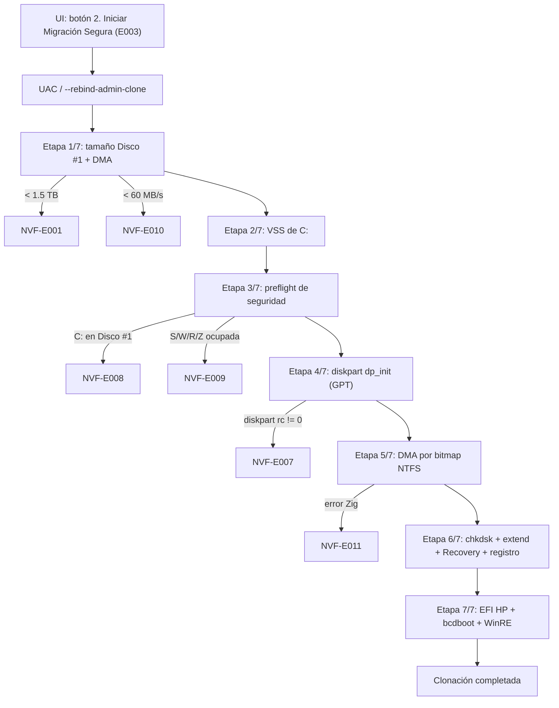

# NVMeForge — Catálogo de Errores (fuente única de verdad)

> Cada error tiene un **ID estable `NVF-Exxx`**. Los mensajes `❌` de la UI muestran ese ID entre corchetes,
> así que lo que reporta el usuario se encuentra aquí directamente.
> **Regla:** todo error nuevo se registra aquí *antes* de corregirlo (ID, cuándo/cómo lo reportó el usuario, etapa, causa, corrección, evidencia, regla).

## Cómo reportar / rastrear un error

1. Copie el texto completo del mensaje `❌ [NVF-Exxx] ...` (o una captura).
2. Adjunte los logs de `%TEMP%\NVMeForge\logs\`:
   - `clone_run.log` — línea por línea con hora de cada etapa y cada comando externo (`CMD <nombre> rc=<código>`). Las corridas anteriores quedan en `logs\runs\clone_run_<inicio>.log` (NVF-E037).
   - `<paso>.log` — salida completa de cada comando (`dp_init.log`, `bcdboot.log`, `vss_create.log`, …) y el script diskpart exacto en `<paso>.txt`.
3. Diagnóstico sin riesgo: `NVMeForge.exe --preflight` → `preflight.log` (no escribe en ningún disco; con Admin también ejecuta `diskpart detail disk` de solo lectura).

## Mapa del flujo → errores posibles

## Índice cronológico

| ID | Reportado (hora local) | Cómo llegó | Mensaje / síntoma exacto | Etapa / zona | Estado |
| :-- | :-- | :-- | :-- | :-- | :-- |
| NVF-E001 | 2026-10-28 ~22:25 | Captura 3 del usuario | `❌ Error de Seguridad: Disco #1 no detectado` | Etapa 1/7 | ✅ Corregido |
| NVF-E002 | 2026-10-28 ~22:25 | Captura 2 del usuario | Ícono de barra de tareas decía `GACO NVMe` | Build / assets | ✅ Corregido |
| NVF-E003 | 2026-10-28 ~22:25 | Captura 1 del usuario | Diálogo `127.0.0.1:8999 dice` | UI `startClone()` | ✅ Corregido |
| NVF-E004 | 2026-10-28 (sesión previa) | Hallazgo interno | UI no cargaba: servidor HTTP bloqueado | Servidor HTTP | ✅ Corregido |
| NVF-E005 | 2026-10-28 (sesión previa) | Hallazgo interno | SAC bloqueaba el `.exe` (CodeIntegrity 3077) | Build / firma | ✅ Corregido |
| NVF-E006 | 2026-10-28 ~22:40 | Texto del usuario: "no debería ser con .ps1… mete muchos errores" | `Build-NVMeForge.ps1` fallaba (`#Requires -Version 7.0` bajo PS 5.1) | Build | ✅ Eliminado (cero `.ps1`) |
| NVF-E007 | 2026-10-28 23:06 | Texto del usuario | `❌ Error inicializando tabla GPT en Disco #1` / "Verifique que ningún archivo esté abierto en el Disco #1." | Etapa 4/7 | ✅ Corregido — pendiente corrida real con Admin |
| NVF-E008 | 2026-10-28 23:09 | Preventivo (auditoría E007) | `❌ [NVF-E008] Bloqueo de Seguridad: C: está en el Disco #1` | Etapa 3/7 | 🛡️ Guardia nueva |
| NVF-E009 | 2026-10-28 23:09 | Preventivo (auditoría E007) | `❌ [NVF-E009] Letra X: ocupada por otro dispositivo` | Etapa 3/7 | 🛡️ Guardia nueva |
| NVF-E010 | — | Guardia existente | `❌ [NVF-E010] Alerta de Enlace USB 2.0 Detectado` | Etapa 1/7 | 🛡️ Guardia |
| NVF-E011 | — | Guardia existente | `❌ [NVF-E011] Error en Transferencia DMA de Bloques NTFS` (ahora incluye `Causa: <error Zig>`) | Etapa 5/7 | 🛡️ Guardia mejorada |
| NVF-E012 | 2026-10-28 23:08 | Hallazgo interno (auditoría E007) | JSON de progreso inválido (`\E` de `\EFI\HP`) → la UI dejaría de actualizar en Etapa 7/7 | `updateProgress` | ✅ Corregido |
| NVF-E013 | 2026-10-28 23:14 | Hallazgo interno (`--preflight`) | Tamaño de C: medido como 488,418 MiB (disco completo) en vez de 454,425 MiB | Etapa 2→4 sizing | ✅ Corregido |
| NVF-E014 | 2026-10-28 23:11 | Error del agente | Se borró `build\` completo (incluía `NVMeForge.rc`) al quitar el `.ps1`; README con ruta de `zig.exe` y flag incorrectos | Proceso / repo | ✅ Restaurado |
| NVF-E015 | 2026-10-28 23:33 | Revisión pedida por el usuario ("revisa si sigue trabajando") | Disco #1 quedó con **dos** MSR: `MSR, EFI, MSR, Windows` | Etapa 4/7 `dp_init` | ✅ Corregido en código (la corrida en curso lo conserva, no impide arrancar) |
| NVF-E016 | 2026-10-28 23:32 | Captura del usuario: UI detenida en `Etapa 6/7 ... 92%` | `chkdsk W: /f` colgado desde 23:27:07 (CPU 0.06 s, log de 0 bytes) esperando respuesta `(S/N)` | Etapa 6/7 | ✅ Corregido en código — la corrida en curso requiere terminar `chkdsk.exe` |
| NVF-E017 | 2026-10-28 23:34 | Hallazgo interno | Las instantáneas VSS `ClientAccessible` son persistentes y nunca se borraban (ya iba en `HarddiskVolumeShadowCopy13`) | Etapa 2/7 | ✅ Corregido en código |
| NVF-E018 | 2026-10-28 23:38 | Texto del usuario: "¿dejaste status/log de errores?" | `bcdboot` podía fallar y aun así salir "✔ 100% verificado" | Etapa 7/7 | ✅ Ahora es error fatal con log |
| NVF-E019 | 2026-10-28 23:38 | Igual que E018 | El mensaje final decía "6 candados verificados" aunque fallaran chkdsk, reg, robocopy o extend | Final | ✅ Mensaje `⚠ [NVF-E019]` con la lista de pasos fallidos |
| NVF-E020 | 2026-10-28 23:38 | Hallazgo interno, confirmado en la corrida de 23:45 (`robocopy_winre` copió 0 archivos) | `Winre.wim` NO está en `C:\Windows\System32\Recovery` cuando WinRE está activo → Recovery del clon vacía | Etapa 7/7 | ✅ Corregido 23:47: se copia desde la partición WinRE del Disco 0 (detectada por GPT, aquí la p4) con `robocopy /B`, se registra con `reagentc /setreimage /target W:\Windows` y se verifica que el archivo exista |
| NVF-E021 | 2026-10-29 00:03 / 00:06 | Captura del usuario: ~21 ventanas "Elegir una aplicación" que se quedan buscando | Ráfagas de `OpenWith.exe -Embedding` (00:02:13 y 00:07:05) | **Externo a NVMeForge** | ✅ Diagnosticado y limpiado |
| NVF-E022 | 2026-10-29 00:09 | Endurecimiento pedido ("perfecciona, es extremadamente delicado") | Si fallaba VSS se clonaba `\\.\C:` **en vivo** (copia inconsistente); si fallaba la medición de C: se usaban 455000 MiB fijos | Etapas 1-2 | ✅ Ahora aborta antes de tocar el disco |
| NVF-E023 | 2026-10-29 00:09 | Igual | El destino se elegía solo por número de disco + tamaño | Etapa 1 | ✅ Identidad física (modelo/serie/bus) registrada y comparada con el origen |
| NVF-E024 | 2026-10-29 00:09 | Igual | Se escribía en `\\.\W:` sin comprobar que W: fuera la partición nueva del Disco #1 | Etapa 4→5 | ✅ Verificación de disco y tamaño de W: antes de escribir |
| NVF-E025 | 2026-10-29 00:09 | Igual | "Candado 5: Checksum" no comparaba nada: la copia nunca se verificaba | Etapa 5 | ✅ Verificación por relectura byte a byte |
| NVF-E026 | 2026-10-29 09:04 | Log de corrida real pegado por el usuario ("¿ya se puede usar?") | `VERIFY clusters comparados=768 diferencias=37 primer_error_lcn=104957312` → "NO use este disco" | Etapa 5 | 🟡 Relectura del 100 % del destino contra huellas de lo escrito (falta prueba en Windows) |
| NVF-E027 | 2026-10-29 15:12 | Revisión de código antes de reclonar (Claude) | Si el 2.º `FSCTL_LOCK_VOLUME` sobre W: fallaba, se escribía igual sin bloqueo exclusivo | Etapa 5 | 🟡 Bloqueo confirmado con reintentos; si no, abortar antes de escribir |
| NVF-E028 | 2026-10-29 15:12 | Revisión de código antes de reclonar (Claude) | Un fallo pasajero de lectura/escritura USB abortaba sin reintento y sin offset ni `GetLastError` en el log | Etapa 5 | 🟡 `positionedIo`: 4 intentos + `IO_ERROR`/`IO_RETRY_OK` en el log |
| NVF-E029 | 2026-10-30 09:14 | Corrida real v2.2 | `VERIFY_BOOT clusters_comparados=256 diferencias=1 primer_error_lcn=1` → `❌ [NVF-E026] ... FALLÓ` (la de 2026-10-29 22:12 tuvo 0) | Etapa 5 | 🟡 v2.3.0: arranque juzgado contra lo escrito; tolerancia solo en `$Boot` fuera del BPB |
| NVF-E030 | 2026-10-30 09:19 | Corrida real v2.2 + captura del usuario ("Disco local (S:)") | `❌ [NVF-E009] Letra S: ocupada por otro dispositivo` — era la partición EFI del Samsung que dejó la corrida fallida | Etapa 3 | 🟡 v2.3.0: liberar S:/R: en toda salida + detección por enlaces DOS |
| NVF-E031 | 2026-10-30 09:05 | Log real: la corrida de 2026-10-29 22:12 terminó bien y la de 09:05 la borró | Nada impedía reclonar encima de un clon terminado | Etapa 1→4 | 🟡 v2.3.0: marca `W:\NVMeForge_CLON_OK.txt` y bloqueo |
| NVF-E032 | 2026-10-30 10:20 | Auditoría del servidor local (Claude) | `POST /api/start-clone` se aceptaba desde cualquier página web abierta en el navegador (podía borrar el Disco 1) | Servidor HTTP | 🟡 v2.4.0: Host + cabecera `X-NVMeForge` + Origin obligatorios |
| NVF-E033 | 2026-10-30 10:27 | Carlos: "cuando se cierra el sistema se queda el PID del proceso corriendo" | `NVMeForge.exe` seguía en memoria tras cerrar la ventana | Servidor HTTP | 🟡 v2.4.0: salida automática sin ventana (nunca durante clonación o benchmark) |
| NVF-E034 | 2026-10-30 10:16 | Auditoría de la interfaz (auditoría interna) | Temperatura, salud, TBW, escritura, IOPS, TRIM, particiones e identidad inventados o fijos; fuentes/iconos de Samsung Magician; logos de Wikipedia | Interfaz | 🟡 v2.4.0: interfaz nueva solo con datos reales |
| NVF-E035 | 2026-10-30 11:37 | Revisión antes de clonar (Claude) | El motor borraba "el Disco 1" aunque no fuera el disco que el usuario confirmó en pantalla | Etapa 1 | 🟡 v2.5.0: la confirmación lleva modelo + tamaño exactos y el motor aborta si no coinciden |
| NVF-E036 | 2026-10-30 11:37 | Revisión antes de clonar (Claude) | Se podía empezar en batería baja o con C: casi llena (la instantánea se borra a mitad) | Antes de la Etapa 1 | 🟡 v2.5.0: batería < 60 % sin cargador o C: < 10 GB libres → no se toca nada |
| NVF-E037 | 2026-10-30 11:37 | Revisión de logs (Claude) | Cada corrida borraba el registro de la anterior (se perdió el de la clonación buena de 2026-10-29 22:12) | Registro | 🟡 v2.5.0: `logs\runs\clone_run_<inicio>.log`, últimas 20 |
| NVF-E038 | 2026-10-30 20:51 | Carlos: "avanza con el sistema" (generalizar NVMeForge para publicarlo como código abierto) | Destino fijo en el Disco 1, origen en el Disco 0, EFI en "disco 0 partición 1", mínimo fijo de 1.5 TB, solo `\EFI\HP`, binario solo para AMD Zen 4 | Etapas 1, 4, 6 y 7 | 🟡 v2.7.0: destino elegido y confirmado, origen = disco de C:, EFI/WinRE por tipo GPT, mínimo calculado, x86-64-v2 |
| NVF-E039 | 2026-10-30 21:54 | Carlos, primera corrida de la v2.7.0: "paso algo mira ya fallo" (captura del Explorador con "Disco local (S:)" sin tamaño) | S: era una letra huérfana de una partición que ya no existe; NVMeForge la tomó por "otro dispositivo" y se detuvo | Etapa 3 | 🟡 v2.7.1: se reconoce la letra huérfana y se le quita solo el nombre; "Antes de clonar" muestra el estado de S:, W:, R:, Z:, Y: |
| NVF-E040 | 2026-10-30 22:33 | Clon completo (v2.8) | Una copia sector por sector entre discos con distinto tamaño de sector lógico (512/4096) deja volúmenes que Windows no abre | Etapa 1 | 🟡 v2.8.0: se comparan los dos tamaños y se detiene antes de tocar nada |
| NVF-E041 | 2026-10-30 22:33 | Carlos: "la intención es clonar" (las particiones de HP de 1.07 GB y 33.3 GB no se copiaban) | Solo se clonaba C:; el resto del disco se perdía | Etapa 6 | 🟡 v2.8.0: clon completo, cada partición extra copiada y releída al 100 %; si una falla, advertencia NVF-E041 |
| NVF-E042 | 2026-10-31 16:00 | Prueba de rendimiento (v3.0) | No se pudo crear el archivo de prueba de 1 GiB en la unidad elegida o no hay 3 GiB libres | Rendimiento | 🟡 v3.0.0: se comprueba el espacio antes de empezar y el mensaje dice la unidad y el error de Windows |
| NVF-E043 | 2026-10-31 16:00 | Prueba de rendimiento (v3.0) | Falló una lectura o escritura del archivo de prueba, o Windows no permitió la E/S asíncrona | Rendimiento | 🟡 v3.0.0: la prueba se detiene, espera a que termine toda la E/S pendiente, borra el archivo y dice en qué prueba falló |
| NVF-E044 | 2026-11-01 00:30 | Revisión de la 2.9 (pendiente) y Carlos: "hazlo más robusto" | Al empezar se quitan todas las letras del disco destino; si la corrida se detenía antes de borrarlo, ese disco quedaba sin letras | Etapa 3-4 | 🟡 v3.0.1: se anotan letra y volumen antes de quitarlas y se devuelven si la corrida se detiene antes de `clean` |

---

## Detalle por error

### NVF-E001 — Disco #1 no detectado
- **Dónde:** `getVolumeLengthBytes` en `src\nvmeforge_engine.zig`.
- **Causa:** `IOCTL_DISK_GET_LENGTH_INFO` (`0x0007405C`) exige `FILE_READ_ACCESS`; se abría `\\.\PhysicalDrive1` con `dwDesiredAccess = 0` → `ERROR_ACCESS_DENIED (5)` incluso con Admin.
- **Corrección:** `GENERIC_READ` + `GET_LENGTH_INFO`; respaldo sin Admin: acceso `0` + `IOCTL_DISK_GET_DRIVE_GEOMETRY_EX` (`0x000700A0`, `DiskSize` en `[24..32]`).
- **Evidencia:** `Disk1_Bytes = 2000398934016`; `--preflight` → `[NVF-E001] ... PASS`.
- **Regla:** verificar el campo *Access* del CTL_CODE antes de elegir `dwDesiredAccess`.

### NVF-E002 — Ícono `GACO NVMe`
- **Causa:** `app.ico` copiado de `gaco_nvme_pro.ico` (texto "GACO" en los píxeles) + caché del perfil del navegador.
- **Corrección:** `.ico` nuevo de 9 capas `FORGE / NVMe`; perfil rotado a `NVMeForge_v22_Profile`; `gaco_nvme_pro.ico` eliminado del repo.
- **Regla:** nunca reutilizar íconos de otro producto; validar DIB/PNG/alpha/AND-mask.

### NVF-E003 — `127.0.0.1:8999 dice`
- **Causa:** `window.confirm()` en `startClone()` (`src\ui.html`).
- **Corrección:** modal propio `nvmeforgeConfirmModal`.
- **Regla:** prohibido `alert()` / `confirm()` / `prompt()`.

### NVF-E004 — Servidor HTTP bloqueado por socket preconnect
- **Causa:** Zig 0.15.2 `stream.read()` usa `ReadFile` sin `OVERLAPPED`; un solo hilo de `accept()` se bloquea con el socket preconnect vacío de Chromium.
- **Corrección / regla:** `stream.reader(&.{})` (WSARecv overlapped) + un hilo por conexión (`clientWorker`).

### NVF-E005 — Bloqueo de Smart App Control
- **Causa:** literales `--no-sandbox` junto a rutas de navegador, imports crudos `recv`/`send`, firma autofirmada que contamina el registro MFT.
- **Regla:** no firmar con certificados locales; si el binario destino está bloqueado, borrarlo antes de compilar; verificar `0` eventos CodeIntegrity `3076/3077` tras cada build.

### NVF-E006 — Scripts `.ps1` frágiles
- **Causa:** `Build-NVMeForge.ps1` con `#Requires -Version 7.0` ejecutado por `powershell.exe` 5.1; los `.ps1` introducían errores de entorno.
- **Corrección / regla:** cero `.ps1` en el repo. Build con `zig build --release=fast` (ver README). Diagnóstico con `NVMeForge.exe --preflight`.

### NVF-E007 — Error inicializando tabla GPT en Disco #1
- **Reporte del usuario (23:06):** después de aceptar UAC, la UI mostró `❌ Error inicializando tabla GPT en Disco #1 — Verifique que ningún archivo esté abierto en el Disco #1.`
- **Dónde:** `cloneWorkerThread` → Etapa 4/7 → `runDiskpartScript("dp_init")`.
- **Causa raíz:** el script comenzaba con `select volume S` / `select volume W` / `select volume R`. El Disco #1 estaba **RAW** (`Get-Disk` → `PartitionStyle RAW`, sin volúmenes) y no existía ninguna de esas letras. `select` no admite `noerr`, y `diskpart /s` **aborta todo el script en el primer comando fallido** → código ≠ 0 → nunca se llegó a `select disk 1` / `clean`. El texto "archivo abierto" era engañoso, y como la salida de diskpart se descartaba no había forma de verlo.
- **Corrección:**
  1. Se quitaron los `select volume` del script (`clean` ya libera cualquier letra del Disco #1); se añadieron `online disk noerr` y `attributes disk clear readonly noerr`.
  2. Nueva Etapa 3/7 (NVF-E008/E009) que valida letras y disco **antes** de borrar nada.
  3. Toda la salida de diskpart se guarda en `%TEMP%\NVMeForge\logs\dp_init.log` (+ script en `dp_init.txt`); la UI muestra el código diskpart y las 2 últimas líneas de su salida.
  4. La limpieza final ahora usa un script por `select volume` (`dp_clean_s`, `dp_clean_r`).
- **Evidencia:** `--preflight` → `[NVF-E007] dp_init sin 'select volume'=PASS`; captura de stdout `PASS`; `zig test` 3/3. **Pendiente:** corrida real con Admin de la Etapa 4/7.
- **Regla:** en scripts `diskpart /s`, todo comando que pueda fallar sin consecuencias lleva `noerr`; `select` no lo admite, así que nunca se selecciona algo que quizá no exista. Siempre capturar la salida a log.

### NVF-E008 — C: en el disco destino (guardia preventiva)
- **Corrección:** `getVolumeDiskNumber('C')` vía `IOCTL_VOLUME_GET_VOLUME_DISK_EXTENTS` (`0x00560000`); aborta si C: vive en el Disco #1.

### NVF-E009 — Letra reservada ocupada (guardia preventiva)
- **Corrección:** `GetLogicalDrives` + dueño del volumen; S/W/R se permiten solo si ya están en el Disco #1 (las libera `clean`); Z: debe estar libre siempre.

### NVF-E010 / NVF-E011 — Guardias de enlace USB y DMA
- E011 ahora reporta el nombre exacto del error Zig (`CannotOpenTargetDma`, `WriteTargetFailed`, …) y registra el intento VSS fallido en `clone_run.log`.

### NVF-E012 — JSON de progreso inválido
- **Causa:** `updateProgress` insertaba textos sin escapar; `"\EFI\HP"` produce `\E` (escape JSON inválido) y `JSON.parse` falla en la UI.
- **Corrección / regla:** `jsonEscapeInto()` escapa `"`, `\` y controles; prueba unitaria `NVF-E012`. Los textos de etapa se escriben normales (sin pre-escapar).

### NVF-E013 — Tamaño de C: mal medido sin Admin
- **Causa:** el respaldo `IOCTL_DISK_GET_DRIVE_GEOMETRY_EX` sobre `\\.\C:` devuelve la geometría del **disco físico** completo.
- **Corrección / regla:** `getVolumePartitionBytes('C')` usa `ExtentLength` de `VOLUME_DISK_EXTENTS` (`[24..32]`). Evidencia: 454,457 MiB = 454,425 + 32 de margen.

### NVF-E014 — Error del agente al limpiar el repo
- **Causa:** `Remove-Item build -Recurse` borró también `build\NVMeForge.rc`; el README apuntaba a un `zig.exe` inexistente y usaba `-Doptimize` (no válido con `preferred_optimize_mode`).
- **Corrección:** `NVMeForge.rc` recreado; README corregido a `C:\DevWork\Depredador\GACO-Core\.tools\zig\zig-x86_64-windows-0.15.2\zig.exe build --release=fast`.
- **Regla:** borrar archivos puntuales, nunca carpetas completas sin listar su contenido; ejecutar cada comando documentado antes de escribirlo en el README.

### NVF-E015 — MSR duplicado en el Disco #1
- **Evidencia (`Get-Partition -DiskNumber 1`, 23:33):** p1 MSR 16 MiB · p2 EFI 260 MiB (S:) · p3 MSR 16 MiB · p4 W: 454,457 MiB.
- **Causa:** en este build de Windows (26200) `convert gpt` ya crea el MSR de 16 MiB; el script además hacía `create partition msr size=16`.
- **Corrección:** se quitó `create partition msr` de `dp_init` (y de la vista previa de `--preflight`). Dos MSR no impiden arrancar; solo es un diseño no estándar.
- **Regla:** después de cambiar un script diskpart, comprobar el diseño real con `Get-Partition` antes de darlo por bueno.

### NVF-E016 — `chkdsk W: /f` colgado en Etapa 6/7
- **Reporte del usuario (23:32):** captura con la barra en `Etapa 6/7: Auto-Expansión ... 92%` sin avanzar.
- **Evidencia:** `clone_run.log` muestra la DMA terminada (322.76 / 322.76 GiB a 668 MB/s, 23:18:53 → 23:27:07); `chkdsk.exe` PID 27276 vivo desde 23:27:07 con 0.0625 s de CPU durante más de 8 min y `chkdsk_fix.log` de 0 bytes.
- **Causa:** W: estaba en uso (indexador, Defender o Explorer recién montado) → chkdsk pregunta `¿Desea forzar el desmontaje? (S/N)`. Con `CREATE_NO_WINDOW` el proceso recibe una consola invisible, `hStdInput = null` → lee de esa consola y espera para siempre.
- **Corrección:** `chkdsk W: /f /x` (desmonta primero, nunca pregunta) + `runLoggedCommand` ahora entrega `NUL` como stdin a **todos** los comandos externos (cualquier pregunta recibe EOF).
- **Regla:** ningún comando externo se lanza sin stdin = `NUL`; usar siempre las banderas no interactivas (`/x`, `/quiet`, `/y`).

### NVF-E017 — Instantáneas VSS acumuladas
- **Causa:** `Win32_ShadowCopy.Create` con `Context='ClientAccessible'` crea una instantánea persistente; nunca se borraba (cada corrida dejaba una y ocupaba espacio de instantáneas en C:).
- **Corrección:** se guarda el `ShadowID` (`<ID>|<DeviceObject>`) y un `defer deleteVssSnapshot()` ejecuta `vssadmin delete shadows /shadow={ID} /quiet` al terminar la clonación, ya sea con éxito o con error.
- **Pendiente:** borrar a mano las instantáneas que dejaron las corridas anteriores (`vssadmin list shadows /for=C:` como Admin).

### NVF-E016 (ampliación) — Watchdog y Registro en vivo
- **Pedido del usuario (23:35):** "¿dejaste status/log de errores para poder hacer todo esto correctamente?" Los logs existían, pero solo en `%TEMP%`; en pantalla la barra seguía en 92 % sin decir nada.
- **Watchdog:** `runLoggedCommandEx` revisa cada segundo la CPU del proceso hijo (`GetProcessTimes`) y el tamaño de su log (`GetFileSizeEx`). Si ninguno cambia en `idle_limit_s` (180 s por defecto, 300 s para chkdsk), o si se pasa de `hard_limit_s` (30 min por defecto, 45 min para chkdsk), lo termina (`rc = 0xDEAD0001` por inactividad, `0xDEAD0002` por tiempo) y escribe `[WATCHDOG ...]` en `clone_run.log`.
- **Registro en vivo en la UI:** `GET /api/log` devuelve el comando en curso con sus segundos y su inactividad, más las últimas líneas de `clone_run.log`. El panel "📜 Registro en vivo" se actualiza cada 1.5 s, pone el contador en rojo si lleva ≥ 60 s sin actividad y tiene un botón para copiar el registro.
- **Evidencia (`zig test` 4/4, 23:39:48):** `waitfor.exe` (sin CPU ni salida) terminado por el watchdog en unos 3 s; `set /p` con stdin `NUL` regresó al instante (`rc=1`).

### NVF-E018 / NVF-E019 — Verificación de cada paso final
- Cada paso de las Etapas 6 y 7 se registra como `STEP <nombre> -> OK|ADVERTENCIA` (los códigos de chkdsk ≤ 1 y de robocopy < 8 cuentan como éxito).
- Si `bcdboot` falla → `❌ [NVF-E018]` y la corrida se detiene: sin bcdboot el Samsung no arranca.
- Si falla otro paso → `⚠ [NVF-E019] Clonación terminada con N advertencia(s)` con la lista de pasos. El mensaje "✔ 100 % verificado" solo aparece si todo salió OK.

### Corrida 2026-10-28 23:18 → 23:45 (binario anterior) — evidencia
- 23:44:41 el usuario pidió usar `gkill` de GACO-Core → `gkill.exe --force --pid=27276` terminó el `chkdsk /f` colgado (NVF-E016). (Antes, `Start-Process -Verb RunAs` desde el agente devolvía "Solicitud no compatible": el entorno del agente no puede mostrar UAC.)
- `dp_expand rc=0` → W: = **1,861.75 GiB**, Healthy; Recovery (p5) 999 MiB creada.
- `reg_load/reg_del_c/reg_hiberboot/reg_unload rc=0` (`reg_del_w rc=1` = el valor no existía, normal).
- `robocopy_efi_hp rc=1` (archivos copiados = OK).
- **`bcdboot rc=0` — "Archivos de arranque creados correctamente."**; `W:\Windows\System32\winload.efi` presente.
- `robocopy_winre rc=0` = **0 archivos**: `Winre.wim` no existe en `W:\Windows\System32\Recovery` → confirma **NVF-E020** (Recovery vacía, sin WinRE en el clon).
- Diseño final: MSR · EFI · MSR · W: · Recovery (NVF-E015 visible en esta corrida).

### Corrida 2026-10-28 23:52 → 2026-10-29 00:06 (binario con watchdog) — evidencia
- Primera corrida **sin intervención**: `dp_init` rc=0 · DMA 326.34 GiB a 650.7 MB/s · `chkdsk /f /x` rc=0 en 2 min 9 s (NVF-E016 resuelto) · `dp_expand` rc=0 · registro rc=0 · `bcdboot` rc=0 · WinRE copiado desde Disco 0 p4 + `reagentc /setreimage` rc=0 (NVF-E020 resuelto) · `chkdsk /scan` rc=0 · `vss_delete` rc=0 (NVF-E017 resuelto) · mensaje final `✔ 100%`.

### NVF-E021 — Ventanas "Elegir una aplicación" (externo)
- **Reporte (00:03 y 00:06):** captura con ~21 diálogos "Elegir una aplicación" que se quedaban girando.
- **Diagnóstico:** `OpenWith.exe -Embedding` lanzados por COM (svchost DcomLaunch) en ráfagas a las 00:02:13 (21) y 00:07:05 (29). Un segundo antes de la primera ráfaga arrancó `pwsh.exe` PID 45624 (padre 2848, **otra herramienta/agente**, no NVMeForge) con `Get-ChildItem 'c:\DevWork\GAMES\MetalSlugLauncher' -Recurse | Where-Object { .FullName -match ... }`: el `$_` se perdió al citar el comando, así que PowerShell intentaba **ejecutar** `.FullName` por cada archivo y Windows abría "Elegir una aplicación" en cada intento.
- **Acción:** `gkill --force --pid=45624` y luego los `OpenWith.exe` → 0 ventanas y 0 nuevas tras 6 s. NVMeForge no lanza `ShellExecute` durante la clonación.
- **Regla (para cualquier agente):** al pasar comandos PowerShell con `-Command "..."` desde otro shell, escapar `$_` (o usar `-EncodedCommand` / comillas simples) — un `$_` perdido convierte un filtro en ejecución de archivos.

### NVF-E022 — Sin copia en vivo, sin tamaños supuestos
- Antes: si `createVssSnapshotInvisible` fallaba se usaba `\\.\C:` montado (NTFS cambiando durante la copia → clon corrupto silencioso); y si fallaba la medición de C: se usaban 455000 MiB.
- Ahora: sin instantánea VSS → `❌ [NVF-E022]` y se aborta **antes de tocar el Disco #1**; sin tamaño de C: → igual.

### NVF-E023 — Identidad física del destino
- `getDiskIdentity()` (`IOCTL_STORAGE_QUERY_PROPERTY`, sin Admin) registra modelo/serie/bus del destino y del disco de C:. Aborta si el modelo está vacío o la serie coincide con la del origen.
- Evidencia (`--preflight` 00:10): destino `SSD 990 PRO 2TB` serie `0000000000000000` bus USB · origen `SK hynix PVC10 HFS512GEM9X173N` serie `FD5B_42CE_...` → PASS.
- **Límite conocido:** el puente Realtek RTL9210 no entrega la serie real (todo ceros); con dos gabinetes iguales la serie no los distingue. Pendiente: confirmación del usuario con el modelo/tamaño mostrado antes de `clean`.

### NVF-E024 — W: verificada antes de escribir
- Tras `dp_init`, `VERIFY W: disco=1 bytes>=C:` con `IOCTL_VOLUME_GET_VOLUME_DISK_EXTENTS`; si no cumple → `❌ [NVF-E024]` antes de escribir un solo sector.

### NVF-E025 — Verificación real de la copia (Candado #5)
- `verifyClonedClusters()`: tras la copia relee y compara byte a byte contra la instantánea VSS congelada los primeros 256 clústeres (1 MiB: `$Boot` e inicio de `$MFT`) + 512 clústeres asignados al azar; solo compara clústeres asignados. Cualquier diferencia → `❌ [NVF-E025] ... NO use este disco`. Línea `VERIFY clusters comparados=... diferencias=...` en `clone_run.log`.
- Evidencia: prueba unitaria `NVF-E025` (archivo idéntico → OK; 1 clúster alterado → `VerifyMismatch`; clúster libre → ignorado). `zig test` 5/5. **Pendiente:** primera corrida real con esta verificación.

### NVF-E026 — Falsas diferencias al releer la instantánea VSS + verificación por muestreo insuficiente
- **Reporte:** 2026-10-29 09:04, corrida real: `VERIFY clusters comparados=768 diferencias=37 primer_error_lcn=104957312` → `❌ [NVF-E025] ... NO use este disco`. La corrida se detuvo en la Etapa 5: **no se ejecutaron chkdsk, expansión, registro, bcdboot ni WinRE**, así que ese Samsung no arranca.
- **Causa:** E025 releía la instantánea VSS y la comparaba con el destino. `volsnap.sys` no protege con Copy-on-Write `pagefile.sys`, `hiberfil.sys`, `swapfile.sys` ni el área de diferencias de VSS; leer dos veces el mismo clúster de la instantánea puede dar datos distintos. 37/512 (~7 %) es coherente con el tamaño de esos archivos. Además, 512 clústeres al azar de ~87 millones no detectan una corrupción localizada.
- **Parche descartado (Gemini, sin compilar):** saltaba diferencias según `FSCTL_LOOKUP_STREAM_FROM_CLUSTER`, pero usaba `0x01000000` como "PAGE_FILE" cuando en `winioctl.h` es `..._ENTRY_ATTRIBUTE_DATA` (lo tiene **todo** flujo `$DATA` normal) → habría ocultado corrupción en casi cualquier archivo. También saltaba clústeres sin dueño, `$LogFile`, `$Bitmap` y `$UsnJrnl` (sí protegidos por VSS) y consultaba el destino desmontado. Respaldo: `src\nvmeforge_engine.zig.bak-gemini-20261029-1019`.
- **Corrección:** durante la copia se calcula XxHash64 (LCN + datos) de exactamente lo que se pasa a `WriteFile`, por segmentos de ≥256 MiB (≤4096 segmentos). Tras la copia se relee **el 100 %** de los clústeres copiados del destino, en el mismo orden (`ClusterRunIter`, compartido por copia y verificación), y se compara cada segmento → `VERIFY_FULL ...` y `VERIFY_BAD_SEGMENT lcn=a..b` en `clone_run.log`. Se mantiene la comparación de los primeros 256 clústeres (`$Boot`) contra la instantánea (`VERIFY_BOOT ...`). Se aborta si el clúster NTFS de origen no es 4 KiB (`FSCTL_GET_NTFS_VOLUME_DATA`). Las corridas no se pasan del último clúster del volumen. `FlushFileBuffers` del destino se registra (`FLUSH ...`).
- **Coste:** una relectura completa del Samsung (~330 GiB, unos 6–9 min a la velocidad del gabinete UGREEN). Barra: copia 20→80 %, verificación 80→90 %.
- **Evidencia:** `zig test src\nvmeforge_engine.zig` en Windows **7/7 PASS** (`NVF-E025 boot region`, `NVF-E026 run iterator`, `NVF-E026 full read-back`, watchdog `NVF-E016`, JSON `NVF-E012`, OEM850 `NVF-E007`) y `zig build --release=fast` compilado y desplegado en `bin\NVMeForge.exe` y `dist\NVMeForge-Portable-x64.exe` (`757,248` bytes, 0 eventos Smart App Control 3076/3077). **Pendiente:** conectar el gabinete USB-C UGREEN con el Samsung 990 PRO 2TB y ejecutar la corrida con `NVF-E026`.
- **Regla:** nunca validar una copia releyendo la instantánea VSS fuera de zonas protegidas por COW; nunca saltar diferencias por heurística de nombres; verificar el 100 % de lo escrito.

### NVF-E027 — Escritura cruda en W: sin bloqueo exclusivo confirmado
- **Dónde:** `executeDmaVolumeClone`, justo antes de la copia.
- **Causa:** `LOCK → (falla) → DISMOUNT → LOCK` ignoraba el resultado del segundo `LOCK`. Si el Explorador, AutoPlay, Defender o el indexador reabrían la W: recién formateada, NTFS podía volver a montarla y escribir metadatos sobre el clon mientras se copiaba.
- **Corrección:** hasta 6 intentos `DISMOUNT + 500 ms + LOCK`; si no queda bloqueada → `error.TargetLockFailed` → `❌ [NVF-E027] No se pudo bloquear W: en exclusiva`, **antes de escribir nada**. Con el bloqueo se desmonta (`LOCK → DISMOUNT`). Línea `LOCK destino W: bloqueado=si|NO intentos=N GetLastError=E` en `clone_run.log`.
- **Regla:** nunca escribir sectores en un volumen sin `FSCTL_LOCK_VOLUME` confirmado.

### NVF-E028 — Errores de E/S USB sin reintento ni diagnóstico
- **Dónde:** bucle de copia, `readClusterAt`, `readRunAt`.
- **Causa:** un solo `ReadFile`/`WriteFile` fallido (fallo pasajero UASP del puente RTL9210) abortaba ~20 min de trabajo; el log solo decía `ReadSourceFailed`/`WriteTargetFailed`, sin posición ni código.
- **Corrección:** `positionedIo()` — misma transferencia en la misma posición (idempotente), 4 intentos con espera 250/500/750 ms; cada fallo deja `IO_ERROR <op> offset=... bytes=... intento=i/4 GetLastError=E`, y la recuperación `IO_RETRY_OK`. La relectura completa (NVF-E026) sigue validando el resultado final.
- **Evidencia:** compila (`zig test --test-no-exec`, `build-exe` x86_64-windows znver4); prueba nueva `NVF-E028 positioned I/O ...`. **Pendiente:** `zig test` en Windows.
- **Regla:** toda E/S cruda pasa por `positionedIo`; todo fallo de E/S se registra con offset y `GetLastError`.

### NVF-E029 — Falso fallo del arranque: clúster 1 de `$Boot` distinto al releer la instantánea (BitLocker)
- **Reporte:** corrida v2.2 de 2026-10-30 09:05: copia completa (347.80 GiB), `FLUSH destino OK`, luego `VERIFY_BOOT clusters_comparados=256 diferencias=1 primer_error_lcn=1` → abortó sin llegar a la verificación completa. La corrida de 2026-10-29 22:12 tuvo 0 diferencias.
- **Causa probable:** C: tiene BitLocker. Los primeros 8 KiB (clústeres 0–1, `$Boot`) son "sectores virtualizados" que `fvevol` sirve por debajo de `volsnap`, así que dos lecturas de la instantánea pueden diferir ahí. Esa zona es código de arranque NTFS que UEFI nunca ejecuta. Además, la comprobación del arranque corría **antes** de la verificación completa y la ocultaba.
- **Corrección (v2.3.0):** durante la copia se guarda una copia exacta de los primeros 256 clústeres **tal como se escribieron**. `verifyBootRegion` compara destino y origen contra esa copia: destino ≠ escrito → fatal siempre; origen ≠ escrito en clústeres 2–255 → fatal; origen ≠ escrito en clúster 1, o en clúster 0 con BPB idéntico (0x00–0x53 y 0x55AA) → se registra `VERIFY_BOOT_ORIGEN_VIRTUALIZADO` con offset y bytes, no es fatal. La verificación completa (NVF-E026) corre **primero**. Las pruebas unitarias ya no escriben en el `clone_run.log` real.
- **Evidencia:** compila (`zig test --test-no-exec` y `build-exe`). Prueba `NVF-E025/E029 boot region` (8 casos). **Pendiente:** `zig test` en Windows y corrida real.
- **Regla:** juzgar la copia contra lo escrito, nunca contra una segunda lectura de la instantánea; ninguna comprobación parcial puede impedir que corra la verificación completa.

### NVF-E030 — Letras S:/R: huérfanas tras una corrida fallida bloquean la siguiente
- **Reporte:** 2026-10-30 09:19 `❌ [NVF-E009] Letra S: ocupada por otro dispositivo`; la captura del Explorador mostró "Disco local (S:)" = partición EFI del Samsung.
- **Causa:** las letras se liberaban solo al final de una corrida exitosa; una corrida que falla en la Etapa 5 dejaba S: asignada. Después, `getVolumeDiskNumber('S')` (`IOCTL_VOLUME_GET_VOLUME_DISK_EXTENTS`) no resolvía el dueño de esa partición EFI → `null` → se trató como "otro dispositivo".
- **Corrección (v2.3.0):** `defer releaseCloneLetters()` justo tras `dp_init`: toda salida (error o éxito) libera S: y R:, y solo si están en el Disco 1. `isLetterOnTargetDisk()` usa los extents y, si fallan, `QueryDosDeviceW("S:")` contra `Harddisk1Partition1..32`, sin abrir el volumen. Línea `LETRA X: en_uso=si disco_extents=... en_disco_destino=si|no`.
- **Regla:** todo recurso que el flujo asigna (letras, instantánea) se libera con `defer`, no solo en el camino feliz.
- **v2.3.1 (2026-10-30 09:53):** la v2.3.0 siguió fallando (`LETRA S: en_uso=si disco_extents=null en_disco_destino=no`): ni los extents ni los enlaces DOS identificaron la partición EFI del Samsung. Ahora `releaseTargetDiskLetters()` quita S:/W:/R: de **cada partición del Disco 1** con `select disk 1` + `select partition N` + `remove letter=X noerr` (mismo patrón que `dp_z_unmount`, probado en una EFI de este equipo) **antes** de revisar las letras; nunca selecciona por letra, así que no puede tocar otro dispositivo. Logs `dp_free_letters_p1..p6`. La línea `LETRA` añade `error_consulta=<GetLastError>`. El mensaje E009 dice cómo ver qué dispositivo usa la letra (`Get-Volume -DriveLetter X`).

### NVF-E031 — Reclonar encima de un clon terminado
- **Reporte:** la corrida de 2026-10-29 22:12 completó las 7 etapas (chkdsk sin errores, bcdboot "Archivos de arranque creados correctamente", reagentc OK). La conexión con el asistente se cortó a mitad, y a las 09:05 se volvió a clonar: `clean` borró el clon bueno.
- **Corrección (v2.3.0):** si bcdboot tuvo éxito se escribe `W:\NVMeForge_CLON_OK.txt` (versión, fecha y estado). Antes de la instantánea, si W: está en el Disco 1 y tiene esa marca → `❌ [NVF-E031] El Samsung ya tiene un clon completo` sin tocar nada. Para reclonar a propósito hay que borrar la marca.
- **Regla:** ninguna operación destructiva sobre un destino que ya contiene un resultado terminado sin una acción explícita del usuario.

### NVF-E032 — El servidor local aceptaba órdenes de cualquier página web
- **Causa:** el servidor en `127.0.0.1:8999` ejecutaba cualquier `POST` sin comprobar de dónde venía. Una página web cualquiera abierta en el navegador podía mandar `POST /api/start-clone` (petición "simple", sin CORS previo) y borrar el Disco 1; también era posible el "DNS rebinding".
- **Corrección (v2.4.0):** `requestAllowed()` en `handleClient`: `Host` debe ser `127.0.0.1:8999` o `localhost:8999`; todo `POST` exige la cabecera `X-NVMeForge: 1` (una cabecera propia obliga al navegador a pedir permiso CORS, que este servidor nunca concede) y, si trae `Origin`, debe ser el propio. Si no → `403`. La petición interna de cierre (`requestExistingBackendShutdown`) manda la cabecera y el `Host` con puerto.
- **Evidencia:** prueba `NVF-E032 only NVMeForge's own page can drive the API` (Host ajeno, POST sin cabecera, Origin ajeno → rechazados; la interfaz y el cierre interno → aceptados).
- **Regla:** toda ruta que cambie algo es `POST` y pasa por `requestAllowed`; nunca acciones por `GET`.

### NVF-E033 — El proceso quedaba vivo al cerrar la ventana
- **Causa:** la ventana es Edge en modo aplicación; al cerrarla, `NVMeForge.exe` (el servidor) seguía corriendo sin interfaz.
- **Corrección (v2.4.0):** la página avisa al cerrarse (`pagehide` → `POST /api/ui-closed` con `keepalive`). `idleExitWatchdog` cierra el proceso si no vuelve ninguna ventana en 5 s (una recarga vuelve antes) o si no hay ninguna petición en 2 min. **Nunca** mientras `g_clone_running` o `g_bench_running`: si se cierra la ventana a mitad de una clonación, el proceso termina la clonación y luego sale.
- **Evidencia:** prueba `NVF-E033 ...` sobre `shouldExitForIdle` (ventana abierta, cerrada, recarga, 2 min, clonación y benchmark).

### NVF-E034 — Interfaz con datos inventados (v2.4.0: interfaz nueva)
- **Antes:** auditoría interna del 2026-10-30 (temperatura fija 38 °C, salud 100 %, escritura = lectura × 0.972, IOPS por fórmula, botón TRIM con `alert()`, Over Provisioning y modos sin efecto, `/api/status` con modelo/serie/particiones escritos a mano, `888.6` por defecto, fuentes e iconos leídos de la carpeta de Samsung Magician, logos de Wikipedia).
- **Ahora:** `/api/status` real: discos 0–15 con modelo, firmware, serie (null si el puente USB la oculta), bus, tamaño, tabla y particiones reales (`IOCTL_DISK_GET_DRIVE_LAYOUT_EX`) con letra, sistema de archivos, espacio y BitLocker (firma `-FVE-FS-`); salud NVMe real (log 0x02 vía `StorageDeviceProtocolSpecificProperty`; null por USB); equipo por SMBIOS (`GetSystemFirmwareTable`): fabricante, modelo, placa, BIOS, CPU, módulos de RAM; versión de Windows (`RtlGetVersion`). `POST /api/bench?disk=N` real y solo lectura (secuencial 1 GiB en 4 zonas + 4 KiB aleatorio 3 s, sin caché de Windows) con historial en `logs\bench_history.tsv`; la escritura no se mide. `GET /api/run-summary`: el registro sin las líneas de progreso. Sin `/magician-assets/`. Lo que no se puede medir se muestra como "No disponible".
- **Interfaz:** `src\ui.html` nueva (verde oscuro, fuente del sistema, sin recursos externos): Clonar (origen → destino con mapas de particiones a escala, pasos, comprobaciones reales, confirmación que muestra qué se borra, progreso por etapa, resultado con "qué se tocó / qué hacer" por código NVF), Discos, Rendimiento, Equipo y Registro. Detecta discos conectados y retirados sin re-escanear. Probada con Playwright a 1460 × 920 y 1100 × 800 en los estados listo, clonando, error y terminado.
- **Evidencia:** 14/15 pruebas en Wine (la de E016 necesita `waitfor.exe`, que Wine no trae); `zig build --release=fast` → 878 592 bytes. **Pendiente:** prueba real en Windows (lecturas de disco, SMBIOS y salud NVMe no se pueden probar fuera de tu equipo).

### NVF-E035 — El disco borrado debe ser el que se confirmó
- **Causa:** la interfaz mostraba un disco y pedía confirmación, pero el motor borraba "el Disco 1" que existiera en ese momento. Una renumeración de Windows (otra unidad USB conectada, el adaptador reconectado) entre la confirmación y el inicio podía hacer que se borrara otro disco. Además, sin permisos de administrador, `start-clone` relanzaba NVMeForge elevado y la clonación empezaba sola al aceptar el aviso de Windows.
- **Corrección (v2.5.0):** `POST /api/start-clone?disk=N&bytes=<tamaño exacto>&model=<modelo>`; el motor guarda esa identidad (`g_expect_*`, una por corrida) y en la Etapa 1 compara modelo y tamaño del Disco 1 (`targetMatchesConfirmed`). Si no coincide → `❌ [NVF-E035]` sin tocar nada. Línea `CONFIRMADO por el usuario: ... -> COINCIDE|NO COINCIDE`. Sin administrador, `start-clone` responde `need_admin` y no arranca nada: primero se dan permisos y luego se confirma. El modo `--clone` por línea de comandos sigue funcionando y lo registra como "sin confirmación de identidad".
- **Evidencia:** prueba `NVF-E035 ...` (parámetros, decodificación %XX, coincidencia exacta de modelo y tamaño). Flujo completo probado con Playwright: el motor recibe `bytes=2000398934016&model=SSD%20990%20PRO%202TB`.

### NVF-E036 — Energía y espacio antes de empezar
- **Causa:** nada impedía empezar una clonación de ~25 min en batería baja, ni con C: casi llena (el área de diferencias de VSS vive en C:; si se llena, Windows borra la instantánea a mitad de la copia). Además `getBatteryInfo` inventaba "95 %" y "con cargador" cuando no podía leer el estado.
- **Corrección (v2.5.0):** `powerAllowsClone`: en batería y por debajo del 60 % → `❌ [NVF-E036]`; un valor desconocido nunca bloquea. C: con menos de 10 GB libres → `❌ [NVF-E036]`. Líneas `ENERGIA ...` y `ESPACIO C: ...` en el registro. `getBatteryInfo` devuelve `null` cuando no sabe (equipo sin batería, 255); `/api/status` y `/api/power` lo reflejan.
- **Evidencia:** prueba `NVF-E036 ...`.

### NVF-E037 — Historial de registros por corrida
- **Causa:** al empezar, `clone_run.log` se renombraba a `clone_run.prev.log` borrando el anterior; dos corridas seguidas (09:05 y 09:18 de 2026-10-30) borraron el registro de la clonación buena de la noche anterior.
- **Corrección (v2.5.0):** `archivePreviousRunLog`: el registro anterior pasa a `logs\runs\clone_run_<AAAA-MM-DD_HHMMSS de su inicio>.log`; se conservan las 20 más nuevas.
- **Evidencia:** prueba `NVF-E037 ...` (nombre a partir de la cabecera).

### v2.5.0 — Mensajes con el disco real
- El mensaje final ya no dice "6 CANDADOS" ni "Samsung SSD 990 PRO 2TB … 1,861.77 GiB" fijos: `✔ Clon terminado y verificado` + modelo real, GiB copiados y releídos, y tamaño final de Windows. Etapa 4 y E001 sin el modelo fijo.
- **Evidencia v2.5.0:** 17/18 pruebas en Wine (E016 necesita `waitfor.exe`); `zig build --release=fast` → 900 608 bytes, `--version` → 2.5.0.

### v2.6.0 — Peticiones de Carlos tras probar la 2.5.0 (2026-10-30 12:21)
- **Temperatura (no la encontraba):** solo se leía con administrador y estaba escondida en Discos. Ahora la salud NVMe se consulta sin administrador (y también durante una clonación) y, si el disco no responde al log NVMe, se usa `StorageDeviceTemperatureProperty` de Windows con sus umbrales de aviso/crítico. Panel con gráfica de la sesión (últimos 10 min), mín./media/máx., e indicador de vida restante (100 − "percentage used" del log NVMe). La temperatura aparece también en las tarjetas de Clonar. Solo se colorea con los umbrales que reporta el propio disco.
- **"100 % clonado" y "ya no está al 100 %":** al terminar una clonación se guarda en `logs\clones.tsv` (fecha, modelo, tamaño, GiB copiados, estado y la posición del diario USN de C: tomada justo después de la instantánea). Clonar muestra "100 % clonado y verificado" y cuántos archivos de C: cambiaron desde ese clon, contados del diario de cambios de NTFS (`FSCTL_READ_USN_JOURNAL`, solo lectura, máx. 4 s); si el diario ya no llega hasta el clon o se reinició, lo dice.
- **El registro confundía:** el Registro y Clonar indican de qué corrida es (fecha, versión, resultado y si es anterior a abrir la ventana), con selector de las corridas archivadas (`/api/runs`, `/api/run-summary?run=`, `/api/log?run=`; nombres validados, nunca rutas).
- **Temas:** Bosque (verde oscuro, por defecto), Grafito, Medianoche y Claro; se recuerda por equipo.
- **"Abrir en ventana propia":** eliminado (NVMeForge siempre abre su propia ventana).
- **Abrir y cerrar rápido:** la interfaz se dibuja de inmediato y cada dato aparece en cuanto llega; al cerrar la ventana el proceso termina en ~2 s (antes 5 s).
- **Rendimiento:** compara cada medición con la anterior del mismo disco.
- **Evidencia:** 20/21 pruebas en Wine (nuevas: diario USN V2/V3, nombres de corrida, historial de clones); interfaz revisada con Playwright en los 3 temas oscuros/claro a 1460 y 1100 px. `zig build --release=fast` → 954 368 bytes.

### v2.6.1 — Registro limpio en cada sesión (Carlos, 2026-10-30 17:44: "sería correcto que aparezcan limpios los log")
- **Antes:** al abrir NVMeForge, Clonar mostraba como "corrida actual" la de las 09:53 (v2.3.0, con error), aunque no se había hecho nada en esa sesión.
- **Ahora:** al arrancar el servidor, `archivePreviousRunLog()` mueve el `clone_run.log` anterior a `logs\runs`; cada sesión empieza con el registro vacío. Clonar dice "No hay corridas en esta sesión" y una línea con la anterior (fecha, versión, resultado) con enlace a Registro. En la vista de eventos, las líneas `CMD ... :: <comando>` se acortan a `CMD nombre rc=N`; el comando completo sigue en "Ver registro completo".

### NVF-E038 — Discos fijos: el motor solo servía para esta laptop
- **Reporte:** 2026-10-30 20:51, al decidir publicar NVMeForge como código abierto ("avanza con el sistema"): tenía que servir con cualquier disco de origen, cualquier destino por USB y cualquier tamaño suficiente.
- **Causa:** el motor suponía este equipo: destino = `TARGET_DISK = 1`; origen = Disco 0 (`select disk 0` para la EFI y `findRecoveryPartitionNumber(0)`); EFI de origen = "partición 1"; solo se copiaba `\EFI\HP`; mínimo fijo de 1.5 TB (`MIN_TARGET_BYTES`); compilado para `znver4` (no arranca en Intel ni en AMD anteriores a Zen 4). Con dos adaptadores USB conectados, el "Disco 1" podía ser cualquiera.
- **Corrección (v2.7.0):**
  - **Destino elegido:** `POST /api/start-clone?disk=N&bytes=...&model=...` exige `disk`; `validTargetChoice` lo rechaza si es el disco de C: o no existe; se guarda en `g_target_disk` solo para esa corrida. `/api/status` ya no trae un destino fijo: `target_disk` es una preselección solo si hay **exactamente un** disco además del de Windows (`soleCandidate`); con varios, la interfaz muestra "¿En qué disco clonar?" (número, modelo, tamaño, conexión y serie) y no deja clonar hasta elegir. Por línea de comandos, `--clone --target=N` (obligatorio) y `--preflight [--target=N]`.
  - **Origen = disco de C:** sin `orelse 0`; si Windows no dice en qué disco está C:, se aborta con `❌ [NVF-E038]` antes de tocar nada.
  - **EFI y WinRE por tipo GPT:** `findGptPartitionInLayout` / `findGptPartition` (EFI `C12A7328-…`, WinRE `DE94BBA4-…`) en el disco de C:. Se conservan **todas** las carpetas del fabricante (`robocopy Z:\EFI S:\EFI /E /XD Z:\EFI\Microsoft Z:\EFI\Boot`); `\EFI\Microsoft` y `\EFI\Boot` los escribe `bcdboot`. Sin EFI de origen (BIOS/MBR) solo se instala el arranque UEFI nuevo.
  - **Tamaño mínimo calculado (NVF-E001):** `planClone`: EFI = máx(260 MiB, EFI de origen), Windows = C: + 32 MiB, WinRE = máx(1000 MiB, WinRE de origen), + MSR 16 MiB + 64 MiB de margen. `buildInitScript` y `buildExpandScript` usan esos tamaños. Línea `PLAN destino: ...` en el registro. E001 dice cuánto mide el disco y cuánto necesita.
  - **CPU:** `build.zig` apunta a `x86_64_v2` (SSE4.2 + POPCNT, lo que exige Windows 11 24H2).
  - **Código abierto:** sin logotipos de marcas ni ruta `/brand-logos` (los SVG pasaron a `_privado\marcas`); cabecera GPL en el motor; `VERSIONINFO` en el `.exe` (ProductName NVMeForge 2.7.0); `LICENSE`, `README.md`, `CODE_SIGNING_POLICY.md`, `SECURITY.md`, `CHANGELOG.md`, `.gitignore`, `.github/workflows/build.yml`. El motor Rust anterior, el instalador y las notas internas pasaron a `_privado\` (ignorado por git).
- **Evidencia:** 25/26 pruebas en Wine (nuevas: elección de destino, preselección, plan de tamaños, scripts diskpart con el disco y tamaños elegidos, búsqueda de particiones GPT por tipo; E016 necesita `waitfor.exe`, que Wine no trae). Interfaz probada con Playwright con 3 discos además del de Windows (uno muy chico, deshabilitado): nada preseleccionado, botón bloqueado hasta elegir, la elección se mantiene entre refrescos y el motor recibe `disk=3&bytes=4000787030016&model=...`; con un solo disco se preselecciona. `--clone` sin `--target` → código 2 sin tocar nada. En este equipo (C: en el Disco 0, EFI 260 MiB, WinRE ~911 MiB, Samsung en el Disco 1) el plan es el mismo de la v2.6.1: EFI 260 MiB, WinRE 1000 MiB.
- **Regla:** NVMeForge nunca supone números de disco ni de partición ni modelos: el destino lo elige y confirma el usuario, el origen es el disco de C:, las particiones se buscan por tipo y los tamaños se calculan. Con varios discos posibles, nunca adivina.

### NVF-E039 — Letra huérfana: S: de una partición que ya no existe
- **Reporte:** 2026-10-30 21:54, primera corrida real de la v2.7.0 (destino confirmado, instantánea creada): `❌ [NVF-E009] Letra S: ocupada por otro dispositivo`. Captura del Explorador: "Disco local (S:)" con un signo de interrogación y sin tamaño. Carlos: "te imaginas cobrar por esto".
- **Evidencia del registro:** `LETRA S: en_uso=si disco_extents=null en_disco_destino=no error_consulta=2` (abrir `\\.\S:` da ERROR_FILE_NOT_FOUND). En `dp_free_letters_p2.log` (la EFI del Samsung) diskpart dijo "La letra de unidad especificada no es válida": S: no era de esa partición ni de ninguna otra del destino. Es decir, S: apuntaba a un volumen que ya no existe (quedó de una corrida anterior en la que la EFI del Samsung tuvo S: y después se recreó la tabla). NVMeForge lo trataba igual que un dispositivo real y se detenía. Es el mismo síntoma de las 09:19 y 09:53, con otra causa.
- **Corrección (v2.7.1):**
  - `isOrphanLetterEvidence` / `orphanLetterTarget`: una letra es huérfana solo si `\\.\X:` falla con "no encontrado" (2/3) **y** el dispositivo NT al que apunta (`QueryDosDeviceW` → `\Device\...`, abierto por `\\?\GLOBALROOT`) tampoco existe. `subst` (`\??\...`), unidades de red (`GetDriveTypeW` = remota) y volúmenes reales que solo niegan el acceso (una EFI, un lector de tarjetas vacío) nunca califican.
  - `freeOrphanLetter`: quita solo el nombre (`DeleteVolumeMountPointW`, lo mismo que `mountvol X: /D`; si sigue, `DefineDosDeviceW` con `DDD_REMOVE_DEFINITION | DDD_EXACT_MATCH_ON_REMOVE` sobre ese destino exacto). No puede tocar datos: el dispositivo ya no existe. Línea `LETRA X: huerfana (apuntaba a ..., que ya no existe) ... -> LIBERADA | SIGUE OCUPADA`.
  - Si Windows no deja quitarla: `❌ [NVF-E039]` con qué hacer (reiniciar, o `mountvol X: /D` como administrador).
  - `/api/status` trae `letters` (`free`, `volume` + disco, `orphan`, `unknown`) y "Antes de clonar" muestra "Letras que usa NVMeForge": huérfana = aviso (se quita al empezar); de otro disco o desconocida = bloquea y dice cuál ("la usa el disco 0 (modelo)"). `--preflight` también las informa.
  - NVF-E009 nombra el disco que usa la letra.
- **Evidencia:** prueba `NVF-E039 ...` (solo cuenta como huérfana con las dos pruebas de "no existe"; `subst`, acceso denegado y "no listo" nunca); en Wine, una letra Q: creada hacia `\Device\HarddiskVolume99` se detecta como huérfana y se libera, y C: nunca. 26/27 pruebas (E016 necesita `waitfor.exe`). Interfaz con Playwright: huérfana → aviso y se puede clonar; S: del disco 0 → bloquea nombrando el disco; S: del destino → bien; Z: desconocida → bloquea.
- **Regla:** antes de bloquear por un recurso "ocupado", comprobar si de verdad existe lo que lo ocupa; y todo lo que puede detener la corrida se muestra en "Antes de clonar", no solo a mitad de la corrida.

### NVF-E041 / NVF-E040 — Clon completo (v2.8.0)
- **Reporte:** 2026-10-30 22:23, Carlos: "esto no sabía que no lo hacía, la intención es clonar". Su disco tiene, además de EFI, MSR, C: y WinRE, dos particiones de HP (1.07 GB y 33.3 GB) que la v2.7 no copiaba.
- **Corrección (v2.8.0):** `parseGptEntries` lee toda la tabla GPT del disco de C:; `selectExtraPartitions` toma todo lo que no es EFI, MSR, C: (por offset) ni la WinRE que se recrea (por número). Solo se copian tipos de datos básicos y de recuperación sin letra; con letra (en uso) = `skip_mounted`; Storage Spaces/LDM/desconocidos = `skip_unsupported` (nunca se duplican mientras el origen está conectado). `dp_expand` reserva su espacio al final (tamaño en MiB redondeado + 64 MiB de margen) y crea una partición vacía por cada una con su mismo tipo. Solo si `dp_expand` terminó bien, R: está en el destino y las particiones que siguen a R: coinciden **exactamente** (cantidad, orden, tipo y tamaño pedido; `mapExtrasToTarget`), se les quita la letra por número de partición, se comprueba que W: y R: siguen en el destino y `copyExtraPartition` copia cada una: bloquea la partición de origen (si no se puede bloquear, no se copia), bloquea y desmonta la de destino (NVF-E027), copia en bloques de 8 MiB y relee el 100 % comparando XxHash64. Los atributos GPT se ponen después de copiar. Cualquier falla → advertencia `particion_extra_N` y NVF-E041 en el registro; Windows queda igual de completo. NVF-E040: tamaños de sector distintos → se detiene antes de tocar nada. `/api/status`: `extra_partitions`, `extra_bytes` y `logical_sector_bytes` por disco; "Antes de clonar" muestra "Particiones que se copian" y "Mismo tamaño de sector".
- **Revisión independiente** (agente separado, antes de entregar): encontró que el mapeo podía tomar R: como destino de una extra de tipo WinRE, que se copiaba aunque `dp_expand` fallara, que `remove all` dependía del foco de volumen de diskpart, que el origen no se bloqueaba, que no había lista de tipos permitidos, que los atributos (solo lectura) se ponían antes de copiar y un búfer de nombre de 80 bytes. Todo corregido y con prueba.
- **Evidencia:** 28/29 pruebas en Wine (nuevas: selección de las particiones de HP de este equipo, guion de diskpart, GUID en texto, mapeo estricto después de R:, tipos no soportados; E016 necesita `waitfor.exe`). Interfaz con Playwright en 4 casos (normal, sectores distintos, D: en uso, motor anterior) sin errores.
- **Regla:** clonar es clonar el disco completo. Nunca se escribe en una partición del destino que no se haya identificado exactamente; si algo no cuadra, no se escribe y se avisa.

### v2.9.0 — Fases aprobadas por Carlos tras el primer clon completo real (2026-10-30 23:23)
- **Clon real con la 2.8.0 (22:54–23:19):** 374.4 GiB copiados (615 MB/s, 10 min 23 s) y releídos (751 MB/s, 8 min 30 s) sin diferencias; particiones de HP 5 y 6 copiadas y releídas sin diferencias; letra huérfana S: liberada sola (NVF-E039); bcdboot y WinRE OK; total 25 min. Carlos: "está lento y hace falta muchas cosas aún"; aprobó F1–F4 para trabajar de noche.
- **F1 velocidad:** `RunPrefetcher` (hilo de lectura adelantada, 4 × 8 MiB, orden FIFO) en la copia y en la relectura; `excludeFileClusters` quita del mapa los clústeres de pagefile/hiberfil/swapfile (salvo su primer MiB y las zonas de borde) y se comprueba que se borraron del clon (`borrar_pagefile_hiberfil`); sin `chkdsk /scan` final.
- **F2 progreso:** `copy_total`, `copy_done`, `verify_done` y `eta_sec` en `/api/progress`; porcentaje continuo (copia 20→52, relectura 52→86, particiones extra 88→94).
- **F3 arranque:** archivos de arranque + `bcdedit /store <EFI>\EFI\Microsoft\Boot\BCD /enum {default}` con `partition=<letra de Windows del clon>` dos veces y `winload.efi` (`bcdPointsTo`); advertencia `arranque_revisado` si falla.
- **F4 letras:** `chooseCloneLetters` (prefiere S W R Z Y; si están ocupadas, otras libres) y plantillas `@S @W @R @Z @Y` (`substLetters`/`L`, tamaño comprobado al compilar). La marca NVF-E031 se busca en cualquier letra del disco destino. `roleOnDisk` antes de cada paso que usa una letra. `/api/status` trae `letters_plan`.
- **Revisión independiente** (agente separado): sin defectos críticos; corregido: guardas por letra (una USB conectada durante la copia podía tomar la letra de WinRE/EFI), `L()` comprobado al compilar, borrado de pagefile/hiberfil verificado, registro con candado entre hilos, sin unidades de red al buscar la marca. Nota: al empezar se quitan todas las letras del disco destino; si el clon se detiene antes de `clean`, ese disco queda sin letras (se le pueden volver a poner en Administración de discos).
- **Evidencia:** 34/35 pruebas en Wine (nuevas: lectura adelantada en orden con los bytes correctos, letras libres, plantillas, BCD, exclusión de pagefile, tiempo restante; E016 necesita `waitfor.exe`). Interfaz con Playwright en 9 casos sin errores. **Pendiente:** medir la velocidad real en el próximo clon.

### NVF-E042 / NVF-E043 — Salud completa y banco de 4 pruebas (v3.0.0)
- **Reporte:** 2026-10-31, tras clonar al Samsung 990 PRO 2TB y arrancar de él, Carlos tuvo que usar CrystalDiskInfo y CrystalDiskMark para saber si el disco rendía (PCIe 4.0 x4, 7,038/6,560 MB/s, 27 frenadas por calor registradas) y pidió que NVMeForge lo mostrara: "estaría más completo". Aprobó F10 + F11 y descartó F12 (IA): "siento que va a dejar de ser el sistema que quiero".
- **F10 (Discos):** `diskcheck.parseThermal` lee del log de salud NVMe los minutos sobre la temperatura de aviso/crítica (bytes 192/196), sensores (200-215), transiciones y tiempo del control térmico (216-231) y tiempo ocupado (96); `queryIdentify` (Identify Controller: versión, WCTEMP/CCTEMP, VWC, HCTMA); `queryTrim` (propiedad 8), `queryWriteCache` (propiedad 4, incluido el "vaciado desactivado"); `queryPcieLink` (SetupAPI → número de disco → padre PCI → DEVPKEY_PciDevice_Current/MaxLinkSpeed/Width); `queryPower` (ASPM con cargador/batería y modo de energía solo en el plan Equilibrado); `osTrimEnabled` (DisableDeleteNotification). Identify y PCIe se guardan 60 s / 10 s para no consultar el disco en cada refresco. Diagnóstico con qué hacer en cada punto.
- **F11 (Rendimiento):** SEQ1M Q8T1, SEQ1M Q1T1, RND4K Q32T1, RND4K Q1T1, primero lectura y luego escritura, 1/3/5 pasadas de 5 s (se queda la mejor), 3 s de pausa entre pruebas. Archivo oculto `X:\NVMeForge-prueba.tmp` de 1 GiB lleno con datos aleatorios, abierto con NO_BUFFERING | OVERLAPPED | DELETE_ON_CLOSE y acceso exclusivo; profundidad de cola con un puerto de finalización de E/S. Un hilo lee la temperatura (log NVMe o, si no responde, la propiedad 51 de Windows), las frenadas registradas y los minutos calientes cada segundo. `/api/suite-start`, `/api/suite`, `/api/suite-cancel`, `/api/suite-history` (`logs\bench_suite_history.tsv`). Al abrir NVMeForge se borra un archivo de prueba que haya quedado por un apagón.
- **Revisión independiente** (agente separado): clon y prueba podían arrancar a la vez (ahora cada lado pone su bandera y revisa la del otro); `drain` podía rendirse y liberar memoria con E/S viva (ahora espera siempre); los contadores de frenadas del log solo cuentan el control térmico del host (HCTM), así que los textos ya no dicen "nunca se frenó": se usan también los minutos calientes y la temperatura máxima contra el aviso del fabricante; texto de la caché sin prometer "sin riesgo"; el modo de energía solo se interpreta en el plan Equilibrado; sensores con hueco; GiB. Todo corregido.
- **Evidencia:** 43/44 pruebas en Wine (nuevas: log térmico con los valores reales del 990 PRO, Identify, caché, enlace PCIe, modo de energía, JSON del progreso, historial; E016 necesita `waitfor.exe`). El banco completo corrió en Wine de punta a punta (archivo creado, 8 pruebas, archivo borrado). Interfaz probada con Playwright (en curso, terminada, disco sin letras, móvil 390 px sin desbordes, sin errores de consola).
- **Regla:** NVMeForge mide y aconseja, no cambia ajustes de Windows. Un texto de diagnóstico nunca dice más de lo que el disco realmente registra.

### NVF-E044 y v3.0.1 — Más robusto
- **Reporte:** 2026-11-01 00:30, Carlos aprobó la 3.0.1: "hazlo más robusto". El clon real con la 2.9.2 (2026-10-31) dejó su registro en el disco viejo, así que no se sabe cuánto tardó; y la revisión de la 2.9 había dejado anotado que un clon detenido al principio deja el destino sin letras.
- **Corrección:** `SavedLetters.capture/restore` (letra → `\\?\Volume{GUID}\` con GetVolumeNameForVolumeMountPointW / SetVolumeMountPointW, solo si la letra sigue libre; se libera antes S:/R: del clon para que la salida no la vuelva a quitar); `defrag <W>: /L` tras las particiones extra (solo registro); `copyLogsToClone` + `flushVolume` antes del mensaje final; `clones.tsv` con columnas opcionales de duración y bytes base (C: usado + extras); el tiempo restante suma el TRIM.
- **Evidencia:** 45/46 pruebas en Wine (nuevas: ruta del registro en el clon, copia de archivos, duración en clones.tsv; E016 necesita `waitfor.exe`). Revisión independiente sin fallas graves; sus 3 recomendaciones y 2 detalles, corregidos.
- **Regla:** si NVMeForge quita algo del sistema del usuario (una letra) y no llega a usarlo, lo devuelve.
